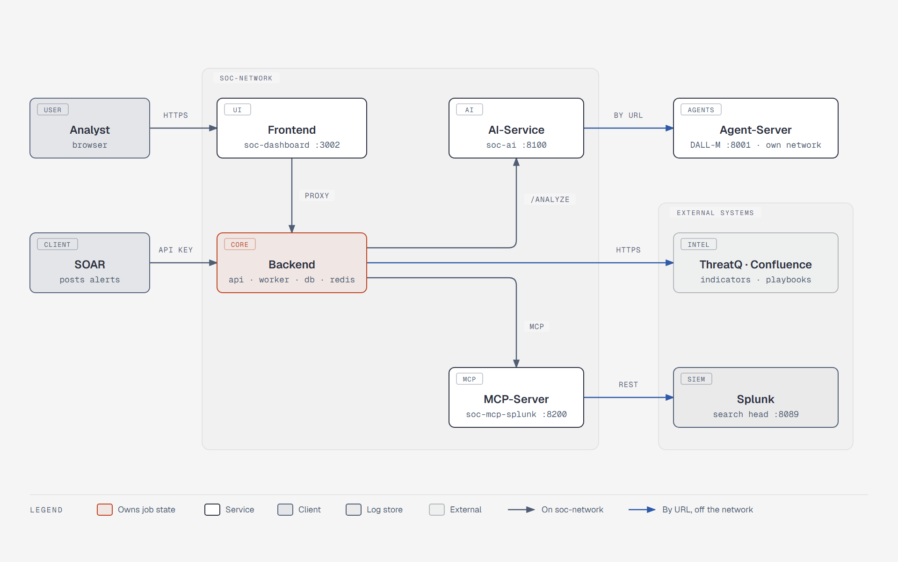

# Agent-Server (DALL-M)

A platform for defining and serving LLM agents. An agent is data: a system
prompt with version history, generation parameters and a model. Every call is
logged with its prompt, response, tokens and latency. FastAPI, Next.js,
Postgres, llama.cpp.

In SOC AI Agent, AI-Service calls this server to run the agents `soc-suggest`,
`soc-requirements` and `soc-conclude`.



## Run

```bash
cp .env.example .env                  # the defaults work for local use
docker compose up -d --build          # the first start downloads a 4.7 GB model
```

Then create the database, register the model, and create the admin user. These
scripts run on the host, once:

```bash
pip install -r script/requirements.txt
python script/create_db.py
python script/insert_default_model.py
python script/add_admin_user.py --username admin --email admin@example.com --password <password>
```

| Open | Address |
| --- | --- |
| Admin UI | http://localhost:7100 |
| API and Swagger | http://localhost:8001/docs |
| llama.cpp chat UI | http://localhost:8080 |
| Postgres | localhost:5497 |

Sign in to the admin UI, create the three agents, and give each an active
prompt. A job fails if its agent is missing, inactive, or has no active prompt.

## Containers

| Container | Role |
| --- | --- |
| `dall-m-server` | FastAPI. Admin CRUD under `/restful`, agent calls under `/v1/agents`. |
| `dall-m-frontend` | Next.js admin UI. |
| `dall-m-db` | Postgres 18. |
| `dall-m-model-preload` | Runs once: downloads the model into `./data/models`. |
| `dall-m-llamacpp` | llama.cpp server. Serves the downloaded model, offline. |

All of them are on the network `dall-m-net`, not `soc-network`.

## API

| Route | Credential | Purpose |
| --- | --- | --- |
| `POST /restful/auth/login` | none | Returns a JWT. |
| `/restful/users`, `/restful/models`, `/restful/agents` | JWT | Admin CRUD. |
| `GET /restful/inference-requests` | JWT | Call history. |
| `POST /v1/agents/{slug}/chat` | **none** | Run an agent. Streams tokens or returns JSON. |

## The model

The model is set in one place: `MODEL` at the top of
`llamacpp/preload_models.py`, in the form `<hf-user>/<hf-repo>[:quant]`. To
change it:

```bash
docker compose up -d --build
python script/insert_default_model.py
```

To use an external OpenAI-compatible API instead of llama.cpp, set
`LLM_BASE_URL`, `LLM_API_KEY` and `LLM_MODELS` in `.env` and start with the
override file the VPS deploy uses:

```bash
docker compose -f docker-compose.yml -f ../Backend/deploy/vps-agent.override.yml up -d --build
```

## Settings

| Variable | Default | Meaning |
| --- | --- | --- |
| `DB_USER`, `DB_PASSWORD`, `DB_NAME` | in `.env.example` | Postgres. Change the password before any deploy. |
| `JWT_SECRET` | `dev-secret-change-me` | Signs admin tokens. Change it before any deploy. |
| `SERVER_HOST_PORT` | `8001` | The API's port on the host. |
| `NEXT_PUBLIC_BASE_URL` | `http://localhost:8001` | The API as the browser reaches it. Set it to the host's address on a server. |

## Known limits

- `/v1/agents/...` and llama.cpp's port 8080 take no token. Anyone who reaches
  the port can run an agent. Do not expose 8001 or 8080 outside a trusted network.
- User passwords are stored in plain text.
- CORS allows every origin.

## More

- Database schema: [readme.database.md](readme.database.md)
- Server internals: [server/readme.server.md](server/readme.server.md)
- Model preloading, hot reload, full configuration: [docs/reference.md](docs/reference.md)
- The whole system: [../README.md](../README.md)
